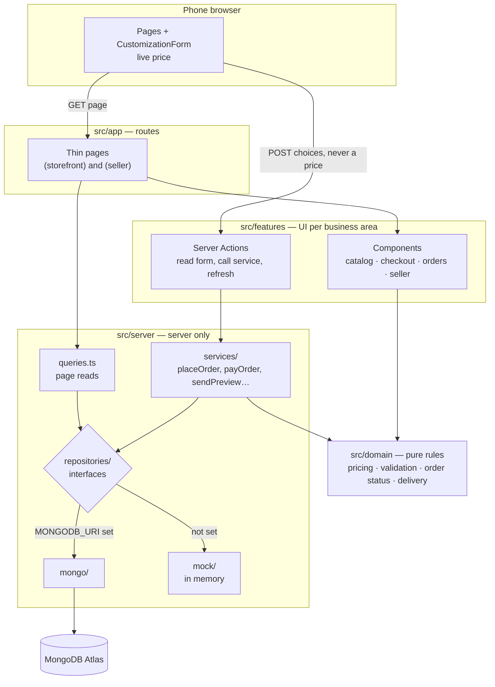
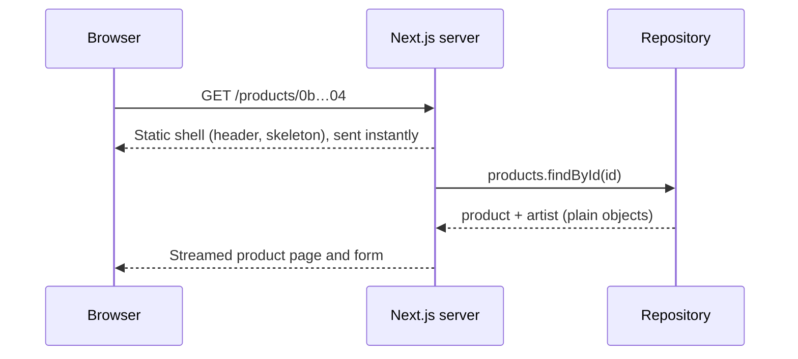
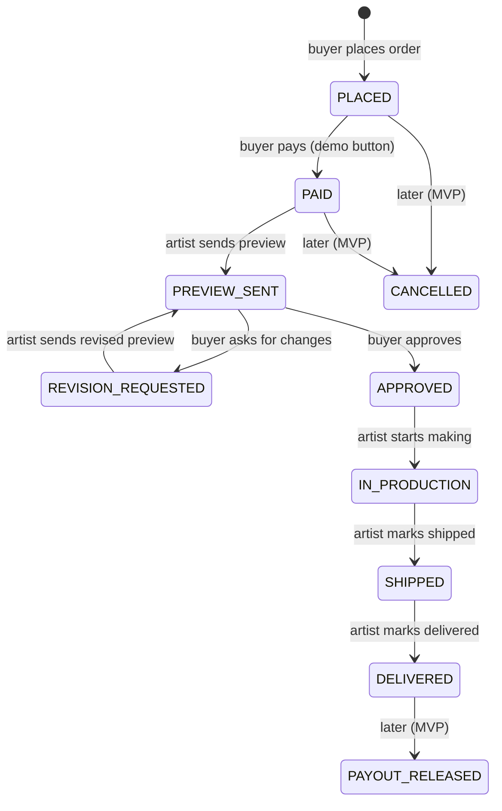
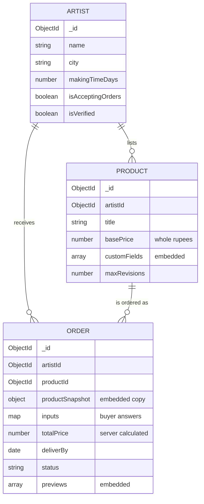

# Kaivannam — Architecture

Nov 10, 2026 · Demo phase

> **Phase 1 update (Nov 20, 2026):** this document describes the code as built for the demo. Phase 1 keeps these layers but replaces MongoDB with Supabase (Postgres, Auth, Storage, Realtime) behind the repositories, and adds payment, shipping and WhatsApp integrations. The target design and task list are in [Kaivannam — Phase 1 Requirements and Tech Tasks](Kaivannam%20—%20Phase%201%20Requirements%20and%20Tech%20Tasks.md); section 15 below is superseded by it.

This document explains how the Kaivannam code is put together: the layers, how a request flows through them, and why it's built this way. Read it before changing code, alongside [Kaivannam — Project Context.md](Kaivannam%20—%20Project%20Context.md) for the product side and [AGENTS.md](../AGENTS.md) for the short "what goes where" rules.

> Diagrams use [Mermaid](https://mermaid.js.org). They render on GitHub. In VS Code, install a Mermaid preview extension to see them.

## 1. The big picture

Kaivannam is a single **Next.js 16** app: the same codebase serves the pages, runs the business logic and talks to the database. Inside it, the code is split into **layers** with one job each, the structure most serious e-commerce codebases settle on, because it lets the store grow (cart, payments, admin, mobile app) without a rewrite.



Four ideas shape everything else:

1. **Pages are thin Server Components.** They read data on the server and compose feature components. Only interactive parts (the customization form, the change-request form, submit buttons) run in the browser.
2. **Every change follows one path:** form → **Server Action** (thin) → **service** (the rules) → **repository** (the storage). The browser never decides prices or statuses.
3. **Business rules are pure functions** in `src/domain`. The browser (instant feedback), the server (the check that counts) and the tests all run the same code.
4. **Storage sits behind interfaces.** The same services work with MongoDB Atlas or with in-memory mock data, chosen by whether `MONGODB_URI` is set.

## 2. Tech stack

| Layer | Choice | Why |
| --- | --- | --- |
| Framework | Next.js 16 (App Router, Cache Components) | Pages, server logic and API in one TypeScript codebase; deploys to Vercel |
| UI | React 19, Tailwind CSS 4, shadcn/ui | Fast mobile-first styling; accessible components we own and can edit |
| Language | TypeScript (strict) | Catches mistakes in prices, statuses and data shapes before runtime |
| Database | MongoDB Atlas + Mongoose 9 | Flexible documents suit per-product custom fields |
| Tests | Vitest | Fast unit tests for business rules and use cases |
| Scripts | tsx | Runs TypeScript scripts like the seed directly |
| Runtime | Node.js 22.12+ (`.nvmrc`) | Required by Next.js 16 and Vitest |

## 3. Folder map

```text
src/
  app/                          ROUTES ONLY
    layout.tsx, not-found.tsx, globals.css
    (storefront)/               buyer pages; the group name doesn't appear in URLs
      page.tsx                  /
      artists/[id]/             /artists/:id
      products/[id]/            /products/:id
      orders/[id]/              /orders/:id
    (seller)/
      dashboard/                /dashboard
  features/                     ONE FOLDER PER BUSINESS AREA
    catalog/components/         ProductCard, CreatorCard, ProductGallery, OccasionChips, HomeHero…
    checkout/                   components/CustomizationForm.tsx, actions.ts (placeOrderAction)
    orders/                     components/ (OrderNextStep, OrderTimeline…), actions.ts (pay, approve, request changes)
    seller/                     components/ (SellerOrderCard, PauseToggle…), actions.ts (send preview, advance, pause)
  server/                       SERVER ONLY
    services/                   orders.ts, artists.ts, result.ts (+ orders.test.ts)
    repositories/               types.ts (interfaces), index.ts (picks one), mongo/, mock/
    db/                         connect.ts, models/{artist,product,order}.model.ts
    queries.ts                  reads for pages
    revalidate.ts               which pages to refresh after a change
    demo-data.ts                demo artists, gifts and orders
  domain/                       PURE BUSINESS RULES (+ *.test.ts)
    types.ts                    Creator, Product, Order… shapes used everywhere
    money.ts                    integer paise, rupees(), percentOf() with one rounding rule
    product-options.ts          option groups (single, multi, text, photo); selections
    pricing.ts                  quoteItem: item total, price lines, production days
    delivery.ts                 estimateDelivery: dispatch and arrival dates
    payment-plan.ts             mockup fee, advance, balance + shipping (Phase 1)
    settlement.ts               commission, GST, TCS, TDS, releases, reconciliation (Phase 1)
    order-lifecycle.ts          Phase 1 statuses, who may act, refunds, deadlines
    order-status.ts             the demo's simpler flow (replaced by order-lifecycle in E6)
    india.ts                    GST state codes, pincodes, GSTIN checksum
    creator-rules.ts            handles, own-state shipping rule
    product-rules.ts            what a product needs before publishing
    buyer.ts                    buyer details, shipping address
    order-number.ts             KV-YYMM-NNNNN order numbers
    seller-dashboard.ts         dashboard totals, deadline labels
    occasions.ts                occasion list
  components/                   SHARED UI
    ui/                         shadcn/ui primitives
    layout/                     SiteHeader, SiteFooter, MockDataBanner
    common/                     SubmitButton, Skeletons
  lib/                          GENERIC HELPERS: dates (IST), format (₹), phone, images, form-data, utils
  config/                       site.ts (brand), env.ts (environment variables)
  test/                         test helpers
scripts/seed.ts                 writes demo-data.ts into Atlas
```

## 4. Layers and their rules

| Layer | Job | May import | Must not contain |
| --- | --- | --- | --- |
| `app/` | Map URLs to pages; fetch with `server/queries`; compose features | features, components, server/queries, domain, lib | Business rules, database calls |
| `features/` | One business area's UI and Server Actions | components, domain, lib, server (services, queries, revalidate) | Rules shared by several areas |
| `server/services/` | Use cases and their rules; return a `Result` | domain, lib, repositories | `FormData`, `revalidatePath`, `redirect` |
| `server/repositories/` | Read and write storage | domain types, db | Business rules |
| `domain/` | Pure business rules and types | lib only | React, Next.js, Mongoose, network |
| `components/`, `lib/`, `config/` | Shared building blocks | each other (lib and config import nothing app-specific) | Feature-specific logic |

Why it's worth the extra folders:

- **Rules in one place.** "Is this phone number valid?" exists once (`domain/buyer.ts`). The form and the server can't disagree.
- **Services don't know about the web.** A future Razorpay webhook calls `payOrder()` exactly like the demo *Pay* button, and tests call it directly.
- **Storage is swappable.** The mock repositories made the app usable before Atlas existed, and they make tests fast.
- **Features are findable.** Everything about the artist dashboard is in `features/seller`, so a new teammate knows where to look.

Server-only modules start with `import "server-only"`, which fails the build if browser code imports them by mistake. Modules the seed script also uses (`db/`, models, `demo-data.ts`) leave it out, because the seed runs outside Next.js.

## 5. Routes

| URL | Reads (`server/queries`) | Writes (Server Actions) | Browser components |
| --- | --- | --- | --- |
| `/` and `/?occasion=birthday` | `getProducts`, `getFeaturedCreators` | — | — |
| `/artists/[id]` | `getCreator`, `getCreatorProducts`, `getCompletedOrderCount` | — | — |
| `/products/[id]` | `getProduct` | `placeOrderAction` | `CustomizationForm` |
| `/orders/[id]` | `getOrder` | `payOrderAction`, `approvePreviewAction`, `requestChangesAction` | `RequestChangesForm`, `SubmitButton` |
| `/dashboard` | `getAllArtists` (picker) | — | — |
| `/dashboard?artist=[id]` | `getCreator`, `getCreatorOrders` | `setAcceptingOrdersAction`, `sendPreviewAction`, `advanceOrderAction` | `SubmitButton` |

There are no logins in the demo. Buyers reach an order through its link; the dashboard picks the artist with `?artist=`.

## 6. Rendering: a static shell, then streamed data

The app uses **Cache Components** (`cacheComponents: true` in `next.config.ts`). For each route, Next.js prerenders a static shell at build time: header, headings and loading skeletons. On each request that shell is sent immediately, and the data streams into it.



- **`loading.tsx`** in each dynamic route folder is the skeleton. Next.js wraps the page in `<Suspense>` with it, so the page can simply `await` its data.
- **The home page** isn't async itself; its data sections each sit in their own `<Suspense>`, so the hero and "how it works" are fully static.
- **`await io()`** starts every function in `server/queries.ts`. It tells Next.js "real I/O follows", so prerendering stops there: `next build` never touches the database, and data is read fresh on every request.
- **Nothing is cached yet** (no `"use cache"`). Order statuses change constantly and traffic is tiny. Catalogue pages are good candidates for caching later (section 14).
- **`MockDataBanner`** also calls `io()`, so "mock data or real database" is decided per request, never baked in at build time.

## 7. Reading data

```text
page.tsx
  → server/queries.ts       await io(), then getRepositories()
    → repositories          mongo/ or mock/
      → plain objects       ids and dates as strings (domain/types.ts)
  → feature components render them
```

**Why plain objects:** Mongo documents contain `ObjectId`s and `Date`s, which can't be passed to browser components. The Mongo repositories use `.lean()` and `serialize()`; the mock repositories hold plain objects and hand out copies. Either way, pages get the same shapes (`Artist`, `ProductWithArtist`, `OrderWithDetails`…).

**Invalid IDs:** every `findById` returns `null` for unknown ids, including strings that aren't valid ObjectIds. Pages turn `null` into `notFound()`.

## 8. Writing data: action → service → repository

Placing an order is the most important flow:

```mermaid
sequenceDiagram
    actor Buyer
    participant F as CustomizationForm (browser)
    participant A as placeOrderAction
    participant S as placeOrder service
    participant R as Repositories
    Buyer->>F: Picks options, types name
    F->>F: quoteItem() shows live total and making time
    Buyer->>F: Place order
    F->>F: Same domain checks for instant errors
    F->>A: FormData with productId, field values, name, phone, deliverBy
    A->>S: placeOrder(input), no price anywhere
    S->>R: products.findById(productId)
    R-->>S: product + artist
    S->>S: Keep only the product's fields, validate them, buyer and date
    S->>S: quoteItem() with the stored product; dates from production days
    S->>R: orders.create(snapshot, inputs, totalPrice)
    R-->>S: orderId
    S-->>A: Result ok with orderId
    A-->>F: revalidate pages, redirect to /orders/orderId
```

Each layer's job:

- **Server Action** (`features/*/actions.ts`): read `FormData`, call the service, then `revalidatePath` and `redirect`. Nothing else.
- **Service** (`server/services`): check the rules, then save. Returns a `Result`, `{ ok: true, value }` or `{ ok: false, error, fieldErrors }`, instead of throwing for expected problems like "artist paused". Takes the repositories as its last argument (`repos = getRepositories()`), which is how tests swap in in-memory data.
- **Repository** (`server/repositories`): talk to storage.

The checkout form submits manually (`onSubmit` + `startTransition`) rather than with `<form action>`, so it can validate first and React doesn't clear the fields after a failed attempt. Simpler forms (pay, approve, send preview, advance, pause) use `<form action={…}>` with a `SubmitButton` that disables itself while pending.

## 9. Order lifecycle

The status rules live in `domain/order-status.ts`, imported by the model, the services and the UI.



| Move | Who | Service | Extra guard |
| --- | --- | --- | --- |
| → PLACED | Buyer | `placeOrder` | Artist accepting orders; all fields valid; date in the delivery window |
| PLACED → PAID | Buyer | `payOrder` | — (stand-in for Razorpay) |
| PAID / REVISION_REQUESTED → PREVIEW_SENT | Artist | `sendPreview` | Preview count unchanged (blocks double-send) |
| PREVIEW_SENT → REVISION_REQUESTED | Buyer | `requestChanges` | Revisions used < `maxRevisions`; note ≥ 5 characters |
| PREVIEW_SENT → APPROVED | Buyer | `approvePreview` | Latest preview still pending |
| APPROVED → IN_PRODUCTION → SHIPPED → DELIVERED | Artist | `advanceOrder` | Must come from the status the button showed |

The revision limit comes from the **order's snapshot**, not the live product, so an artist can't lower it after the buyer has ordered.

## 10. Repositories

### Interfaces

`server/repositories/types.ts` defines one interface per entity:

| Repository | Methods |
| --- | --- |
| `ArtistRepository` | `listFeatured`, `list`, `findById`, `setAcceptingOrders` |
| `ProductRepository` | `list`, `listByArtist`, `findById` |
| `OrderRepository` | `findById`, `listByArtist`, `countCompletedByArtist`, `create`, `updateIf` |

`getRepositories()` in `server/repositories/index.ts` returns the Mongo set when `MONGODB_URI` is set and the shared mock set otherwise. Tests call `createMockRepositories()` for a fresh, isolated copy.

### Conditional updates

`orders.updateIf(id, condition, change)` applies a change **only if the order is still in the expected state**, and reports whether it did. Approving round 2 of a preview, for example:

```ts
repos.orders.updateIf(
  orderId,
  { status: "PREVIEW_SENT", previewCount: 2, lastPreviewResponse: "pending" },
  { status: "APPROVED", answerLastPreview: { response: "approved" } },
);
```

The Mongo repository turns that into a single atomic update:

```js
OrderModel.updateOne(
  { _id: orderId, status: "PREVIEW_SENT", previews: { $size: 2 }, "previews.1.response": "pending" },
  { $set: { status: "APPROVED", "previews.1.response": "approved" } },
);
```

A double-tap, a second tab or a hand-made request finds no matching order and nothing happens. MongoDB applies each update atomically, so no transaction is needed yet; transactions come in when real money moves. The mock repository does the same check and change with no `await` in between, which is equally safe because Node runs one request's synchronous code at a time.

### Mongo vs mock

| | `mongo/` | `mock/` |
| --- | --- | --- |
| When | `MONGODB_URI` set | Not set, and in unit tests |
| Data | MongoDB Atlas | `server/demo-data.ts`, built on first request |
| Persists | Yes | Until the server restarts |
| Connection | `connectDB()` caches one connection on `globalThis`, so hot reloads and warm serverless functions reuse it | Kept on `globalThis` so it survives hot reloads |
| Works on Vercel | Yes | **No**: serverless instances don't share memory |

`scripts/seed.ts` writes the same demo data into Atlas with the same fixed IDs (`0a…` artists, `0b…` products, `0c…` orders), so links keep working after switching.

## 11. Data model



Embedded inside documents (no separate collections):

- **`Product.customFields[]`**: `key`, `label`, `type` (`text`, `image` or `select`), `required`, and `options[]` (`value`, `label`, `priceModifier`). Each product has its own form, which suits MongoDB's flexible documents.
- **`Order.productSnapshot`**: `title`, `basePrice`, `imageUrl`, `maxRevisions`, copied when the order is placed.
- **`Order.inputs`**: the buyer's answers keyed by field `key`. Select fields store the option `value`; the UI looks up labels from the product.
- **`Order.previews[]`**: `imageUrl`, `round`, `response` (`pending`, `approved` or `changes_requested`), `comment`, `createdAt`.

Indexes: `Product.creatorId`, `Product.occasionTags`, `Order.creatorId`, `Order.status`. Models live in `server/db/models/` and are named `CreatorModel`, `ProductModel`, `OrderModel` to keep them apart from the domain types `Creator`, `Product`, `Order`.

## 12. Rules that keep it correct

| Rule | Where it's enforced | Why |
| --- | --- | --- |
| The server decides the price | `placeOrder` recalculates with `domain/pricing.ts`; no price is ever submitted | A tampered request can't change what's charged |
| Only known fields are read | `placeOrder` keeps only the product's `customFields` keys | Extra fields in a request are ignored |
| One set of validation rules | `domain/product-options.ts`, `buyer.ts`, used by form and service | Browser checks can be bypassed; the server repeats them with the same code |
| Snapshot product data into orders | `productSnapshot` | Later edits to a product don't change past orders |
| Status changes are conditional | `orders.updateIf` | No skipped steps or double changes |
| Dates are in Indian time | `lib/dates.ts` (`YYYY-MM-DD` in IST), `domain/delivery.ts` | Vercel runs in UTC; between midnight and 5:30 am IST, "today" would otherwise be wrong |
| Prices are whole rupees | Integer validators in models | Simple maths; multiply by 100 for Razorpay's paise |
| Plain objects to the browser | `domain/types.ts` shapes | ObjectIds and Dates can't cross to browser components |
| Image allowlist | `images.remotePatterns` allows only `images.unsplash.com/photo-*` with our exact query string | Nobody can use our image optimizer for arbitrary URLs |
| Secrets stay local | `config/env.ts` reads them; `.env.local` is git-ignored | The database password never reaches GitHub or the browser |

## 13. Testing

`npm test` runs the unit tests with Vitest; `npm run check` runs types, lint and tests together.

| Test file | Proves |
| --- | --- |
| `domain/pricing.test.ts` | Modifiers add up; unknown options and text fields never change the price |
| `domain/money.test.ts`, `payment-plan.test.ts`, `settlement.test.ts` | Paise rounding; mockup credit and milestones; fees and taxes; 2,000 random orders reconcile to the paisa |
| `domain/product-options.test.ts`, `pricing.test.ts` | Option-group rules, selections, price and production days |
| `domain/order-lifecycle.test.ts` | Both checkout paths, who may act, refunds, deadlines, dispute window |
| `domain/creator-rules.test.ts`, `product-rules.test.ts`, `order-number.test.ts` | Handles, GSTIN checksum, own-state shipping, publish rules |
| `domain/delivery.test.ts` | The delivery window, including the IST-midnight case |
| `domain/buyer.test.ts` | Phone numbers normalise (`+91`, `0`, spaces) and invalid ones fail |
| `domain/seller-dashboard.test.ts` | Dashboard totals and deadline labels |
| `server/services/orders.test.ts` | The whole order lifecycle on in-memory data: injected prices are ignored, steps can't be skipped or repeated, revision limits hold, paused artists can't take orders |

Tests sit next to the code they test. Service tests use `createMockRepositories()` with fresh demo data and a fixed clock, so they're fast and repeatable. `vitest.config.mts` maps the `@/` paths and swaps `server-only` for an empty stub.

Before this restructure and after it, the same 23-step browser walkthrough (order, pay, preview, revise, approve, ship, deliver, pause) passed in both mock and MongoDB mode.

## 14. Trust boundaries and demo gaps

**Trusted:** data loaded from repositories on the server, and code in `domain/` and `server/`.
**Not trusted:** anything from the browser, meaning form fields, URL params and Server Action arguments. They're re-read, validated or ignored.

What the demo deliberately leaves open, all of which must be closed before real launch:

| Gap | Risk | MVP fix |
| --- | --- | --- |
| No authentication | Anyone with an order link can pay, approve or request changes; anyone can advance any order or pause any artist | Services take the signed-in user and check they're the order's buyer or artist |
| Order link is the only access control | ObjectIds are not secret tokens | Buyer login, or an unguessable token in order links |
| `/dashboard?artist=` is open | Anyone can view any artist's orders and buyer phone numbers | Artist login; the dashboard reads the artist from the session |
| Simulated payment | No money moves | Razorpay with Route (held payments), confirmed by webhook |
| Photo fields save only a file name | Artist never sees the buyer's photo | Real uploads (Cloudinary) |

## 15. How the MVP plugs in

> Superseded by the [Phase 1 plan](Kaivannam%20—%20Phase%201%20Requirements%20and%20Tech%20Tasks.md), which follows the PRD (Supabase instead of MongoDB, milestone payments, Shiprocket from Phase 1). Kept for history.

Each roadmap feature has a clear home in this structure:

| MVP feature | Where it goes |
| --- | --- |
| **Auth** (phone OTP; buyer, artist and admin roles) | `features/auth/` for screens, a `UserRepository`, and a session helper in `server/`. Services gain a `user` argument and check ownership. An `(admin)` route group joins `(storefront)` and `(seller)`. |
| **Razorpay + Route** | `features/checkout` creates a Razorpay order for `totalPrice × 100` paise. A webhook route (`src/app/api/razorpay/webhook/route.ts`) verifies the signature and calls the existing `payOrder()` service. Money-moving steps use MongoDB transactions inside the Mongo repositories. |
| **Image uploads** | The browser uploads directly to Cloudinary with a signature from a Server Action; orders and previews store the URL. Add the host to `remotePatterns` and keys to `config/env.ts`. |
| **Cart (several gifts per checkout)** | A `features/cart` area, a `CartRepository`, and a `checkout` service that turns a cart into one order per artist, reusing `placeOrder`'s rules. |
| **Reviews from real orders only** | A `Review` model and repository; a service that allows one review per DELIVERED order. |
| **"Deliver by" filter** | A domain function over production days + transit days (`domain/delivery.ts`), used by a new `products.list` option. |
| **Faster catalogue pages** | `"use cache"` + `cacheTag` in `server/queries.ts`, expired with `updateTag` from the Server Actions that change products or artists. |
| **WhatsApp notifications** (Growth) | A `server/notifications/` module called from Server Actions with `after()`, so the buyer doesn't wait for it. |

Each new storage need is a new repository method implemented in both `mongo/` and `mock/`, so demos and tests keep working on in-memory data.
