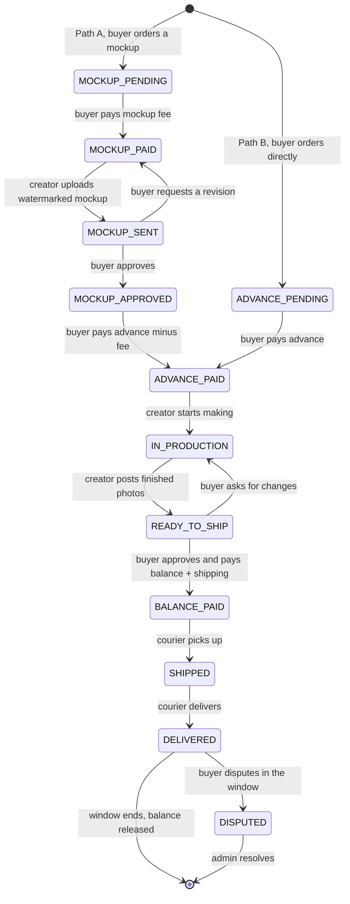
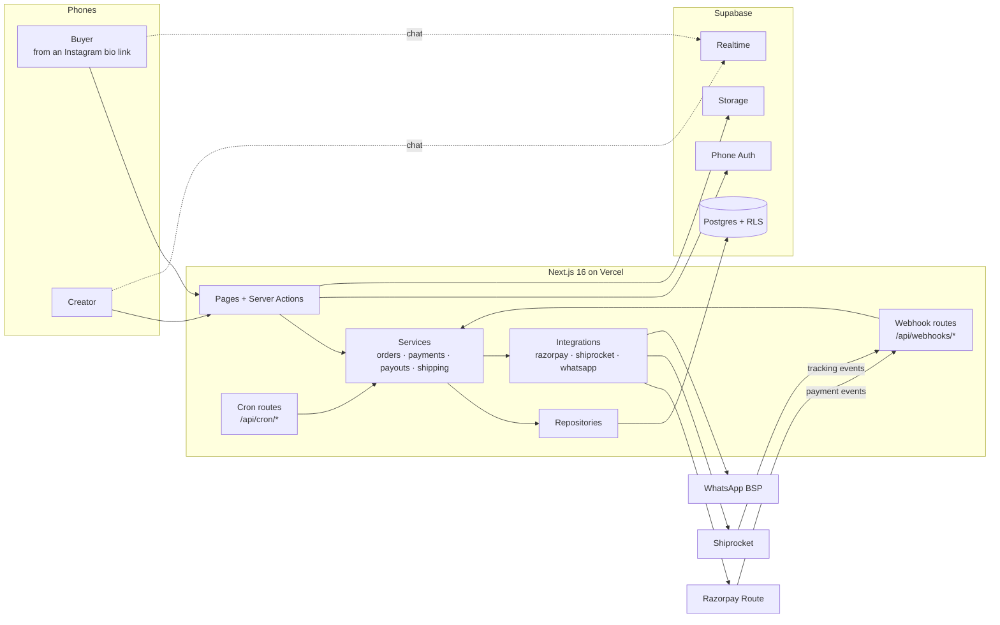
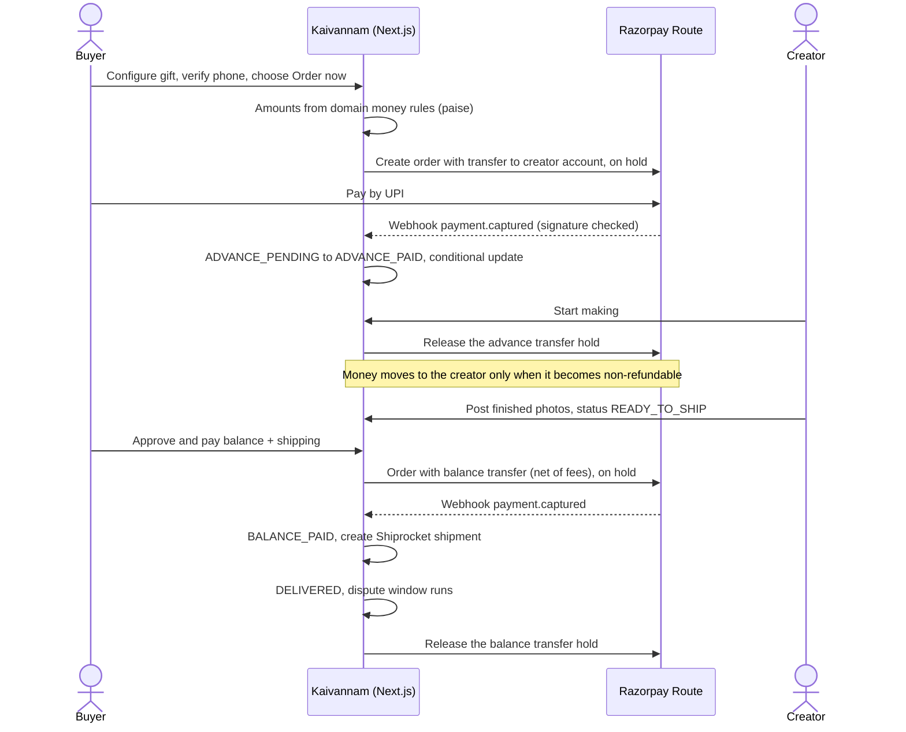

# Kaivannam — Phase 1 Requirements and Tech Tasks

Nov 20, 2026 · Target: **Phase 1 (MVP) — "Smart Order Link"**, full scope · Source: [PRD.md](PRD.md)

The [PRD](PRD.md) says *what* Phase 1 delivers. This document turns it into buildable **requirements** (sections 3–6) and a **task backlog** (section 8), and records the decisions the PRD leaves open (section 2). Where this document fills a gap or proposes something the PRD doesn't say, it's marked **Proposed** and listed in [section 11](#11-open-questions) for confirmation.

> Legal and tax rules here (GST, TCS, TDS, refunds, consumer rules) are summaries to plan the build. **Confirm every one with a CA or lawyer before launch.**

## Contents

1. [Goal and scope](#1-goal-and-scope)
2. [Decisions and PRD gaps](#2-decisions-and-prd-gaps)
3. [Functional requirements](#3-functional-requirements)
4. [Order lifecycle](#4-order-lifecycle)
5. [Money rules](#5-money-rules)
6. [Non-functional requirements](#6-non-functional-requirements)
7. [Technical design](#7-technical-design)
8. [Tech task backlog](#8-tech-task-backlog)
9. [Sequence and timeline](#9-sequence-and-timeline)
10. [Risks](#10-risks)
11. [Open questions](#11-open-questions)

## 1. Goal and scope

**Goal.** An Instagram or WhatsApp gift creator puts `kaivannam.in/<handle>` in their bio. A buyer opens it, configures a gift with a live price and delivery date, pays by UPI in milestones (optional paid mockup → material advance → balance + shipping), approves designs and finished photos in a private order room, and receives a tracked Shiprocket parcel. The creator is paid automatically, minus platform fees, once each payment can no longer be refunded.

**Phase 1 is done when** a real creator can onboard, publish a product, and complete a real-money order end to end on both checkout paths (mockup first, and direct), and the payout ledger matches Razorpay's settlement report to the paisa.

**Payments are built last** (D20). Everything else is built and demoed against a clearly labelled test payment, then Razorpay Route goes in as the final milestone, before any real launch.

### In scope (PRD §7, Phase 1)

| PRD item | Requirements |
| --- | --- |
| Creator onboarding + dynamic product configurator builder | AUTH, ONB, PROD |
| Shareable storefront and product page (`kaivannam.in/<handle>`) | STORE |
| Live price and Shiprocket pincode delivery calculator | STORE, section 5 |
| UPI checkout: paid mockup + 2-stage milestone payments (Razorpay Route) | PAY, section 5 |
| Order chat room with watermarked mockup approval and revision counter | ROOM |
| Shiprocket AWB generation + WhatsApp status notifications | SHIP, NOTIF |
| Implied by the above: payouts, disputes, creator dashboard, admin, legal pages | PAYOUT, DASH, OPS |

### Out of scope (Phase 2 and 3)

Public marketplace homepage, search and occasion or budget filters · buyer reviews and verified galleries · creator analytics · automated GST/TCS ledger export · cart and multiple items per checkout · quantity above 1 · cash on delivery (never, per PRD) · regional languages · native mobile app.

### What carries over from the demo

| Keep | Change | Retire |
| --- | --- | --- |
| Next.js 16 app and the layered `src/` structure (app, features, server, domain) | MongoDB/Mongoose → **Supabase Postgres** behind the same repository interfaces | Mongoose models, Mongo seed, Atlas setup |
| Server-side pricing, product snapshots, conditional status updates | Prices in **paise** (integers) instead of whole rupees | Simulated *Pay* button |
| Customization form with live price | Options grow into **option groups** with extra production days and multi-select add-ons | "Send preview" with a placeholder image |
| Order timeline, preview approval, revision limit | Order status set grows to the PRD's milestones (section 4) | Demo order statuses |
| Artist dashboard, pause toggle | "Artist" becomes **creator** everywhere | `?artist=` dashboard picker (login replaces it) |
| Unit tests, mock repositories | Mock repositories stay for tests and offline demos | Marketplace home and occasion browsing (archived until Phase 3) |

## 2. Decisions and PRD gaps

Status: **PRD** = taken from the PRD · **Proposed** = this spec's suggestion, needs your OK · **CA** = needs a CA or lawyer.

| # | Topic | Decision | Status |
| --- | --- | --- | --- |
| D1 | Database and backend | Supabase (Postgres, Phone Auth, Storage, Realtime) replaces MongoDB. The repository layer keeps the change inside `src/server/repositories`. | **Decided** (Nov 20) |
| D2 | Money unit | Store every amount as integer **paise** (`bigint`). Percentages create fractions of a rupee, and Razorpay works in paise. | **Decided** (Nov 26), done in T1.5 |
| D3 | Domain | `kaivannam.in/<handle>` used as a placeholder; the PRD says `appname.in`. | Open |
| D4 | Where creators can ship | Pan-India per PRD, **except** creators without a GSTIN ship only within their own state. Sellers without GST registration may sell through an e-commerce operator only intra-state. Enforced at the pincode check. | PRD + CA |
| D5 | Mockup fee credit | The paid mockup fee is deducted from the **advance**. | Proposed |
| D6 | When money reaches the creator | **Release each payment when it becomes non-refundable** (PRD §6): mockup fee on first mockup upload; advance when the creator marks *In production*; balance 24h after delivery if no dispute. All three are held in Razorpay Route until then. The PRD says the advance is "settled quickly"; this still happens the day work starts, and keeps refunds simple before that. | Proposed |
| D7 | Advance % | Creator chooses 20–60%, default 50%. The balance must always cover platform fees and taxes. | Proposed |
| D8 | Commission base | Commission is charged on item total minus mockup fee (PRD: 0% on mockup fees), excluding shipping. | Proposed |
| D9 | Gateway fees | PRD: the creator bears gateway fees on mockup fees. For advance and balance it's unspecified. | Deferred to the payments milestone (decide before T13.5) |
| D10 | Extra statuses | Added `ADVANCE_PENDING` (direct order awaiting advance) and `MOCKUP_SENT` (mockup waiting for the buyer). The PRD list has no state for either. | Proposed |
| D11 | Product weight and package size | Added to products. Shiprocket needs them for rates and labels. | Gap |
| D12 | Revision limit | Added `max_revisions` to products; the PRD mentions a limit but has no field. | Gap |
| D13 | Shipping address | Orders store a full address and contact, not just the pincode, for the label. | Gap |
| D14 | OTP channel | SMS OTP in India needs TRAI DLT registration (entity, sender ID, template). Alternative: WhatsApp OTP through the BSP, via Supabase's custom SMS hook. | Open |
| D15 | Income-tax TDS | Section 194-O TDS on e-commerce sales (0.1% since Oct 2024, with an exemption for small individual sellers who give PAN/Aadhaar) is **not in the PRD**. | CA |
| D16 | TCS | PRD's 0.5% matches the rate since July 2024 (the older context doc said 1%). The base needs confirming. | CA |
| D17 | Quantity | One item per order in Phase 1. | Proposed |
| D18 | Dispute window | PRD: 24h after delivery. Gifts are often delivered to someone other than the buyer, who may not see them within 24h; consider 48–72h. | Open |
| D19 | Time limits | Unpaid orders expire after 48h. Creator uploads a mockup within 3 days or the fee is refunded. Buyer pays the balance within 7 days of *Ready to ship* (reminders on days 2 and 5). | Proposed |
| D20 | Build order | Payments are built **last**, as the final milestone of Phase 1 (E13). Until then, checkout and the milestone flow run on a test payment gateway behind a `PaymentGateway` interface, so the order room, shipping and notifications can be built and demoed. The Razorpay Route application still starts on day 1, because its approval is the longest wait. Nothing launches publicly before E13 is done. | **Decided** (Nov 20) |

## 3. Functional requirements

Each requirement has an ID for traceability to tasks. "Done when" is the acceptance check.

### 3.1 Sign-in and accounts (AUTH)

| ID | Requirement | Done when |
| --- | --- | --- |
| AUTH-1 | Everyone signs in with phone number + one-time code. No passwords. | Code arrives within 30 s; repeated wrong codes are rate-limited; session lasts 30 days on the device. |
| AUTH-2 | Roles: `BUYER` (default), `CREATOR` (after onboarding), `ADMIN` (set manually). A creator can also buy. | Admin-only pages and actions reject everyone else. |
| AUTH-3 | Buyers verify their phone inside checkout, with no separate sign-up step. | A first-time buyer goes from configurator to payment with one code entry. |
| AUTH-4 | Every service checks who is acting, not just the page. | Tests prove buyer A can't read or act on buyer B's order, and creator X can't act on creator Y's orders or products. |

### 3.2 Creator onboarding (ONB)

| ID | Requirement | Done when |
| --- | --- | --- |
| ONB-1 | Profile: display name, unique handle, bio, avatar, Instagram link. | Handle is 3–30 characters of `a–z 0–9 . _ -`, unique, not on the reserved list; it becomes `kaivannam.in/<handle>`. |
| ONB-2 | Pickup address with pincode; state comes from the pincode. | Pincode is serviceable; the address is registered as the creator's Shiprocket pickup location. |
| ONB-3 | Payout setup through a Razorpay Route linked account (PAN, bank account). | Products can't be published until the linked account is active. Creator sees KYC status. |
| ONB-4 | Optional GSTIN. | Format validated. Without a GSTIN, buyers outside the creator's state can't check out (D4). |
| ONB-5 | Pause toggle (from the demo). | A paused storefront still shows products but blocks new orders. |
| ONB-6 | Commission plan per creator: 5–8%, 0% for the first 30 days (PRD §6). | Set by admin; the rate in force is copied onto each order when it's placed. |

### 3.3 Product configurator builder (PROD)

| ID | Requirement | Done when |
| --- | --- | --- |
| PROD-1 | Basics: title, description, up to 6 photos, base price, base production days, revision limit, weight and package size. | Can't publish without a photo, a price, production days and weight. |
| PROD-2 | Option groups: single choice, multiple choice (add-ons), text, photo upload. Each option has a price modifier and extra production days. Groups can be required or optional; multiple choice has min and max picks. | The builder's live preview shows the same total and days the buyer will see. |
| PROD-3 | Paid mockup toggle with a fee of ₹99–₹199. | When off, buyers only see the direct path. |
| PROD-4 | Advance percentage, 20–60% (D7). | Validated so the balance always covers fees. |
| PROD-5 | Listed on storefront, or hidden (works by direct link only). | Hidden products don't appear on `/<handle>`. |
| PROD-6 | Editing a product never changes existing orders. | Orders keep a snapshot: title, chosen options with prices and days, totals, revision limit, advance %, mockup fee, commission rate. |

### 3.4 Storefront and configurator (STORE)

| ID | Requirement | Done when |
| --- | --- | --- |
| STORE-1 | `kaivannam.in/<handle>` shows the creator's profile and listed products. | Link previews (Open Graph) look right in Instagram and WhatsApp. |
| STORE-2 | `kaivannam.in/<handle>/<product>` is the configurator: options, custom text, up to 5 reference photos (compressed in the browser), live total and production days. | Totals update instantly using the same rules the server runs. |
| STORE-3 | Delivery pincode check: serviceable or not, shipping estimate, estimated delivery date = today + production days + courier transit days. | Uses Shiprocket serviceability; results cached 24h; unserviceable or out-of-state (D4) pincodes can't check out. |
| STORE-4 | When the product has a paid mockup, two buttons: "Get a mockup first (₹149)" and "Order now (pay 50% advance)". | Each shows what's paid now and what's paid later. |
| STORE-5 | Share tools: copy link, share to WhatsApp. | — |

### 3.5 Checkout and payments (PAY)

Payments are built in the final milestone (D20). Until then, a test gateway stands in for Razorpay, and every requirement below except PAY-2, PAY-7 and the real transfers in PAY-8 and PAY-9 can be built and tested.

| ID | Requirement | Done when |
| --- | --- | --- |
| PAY-1 | Checkout collects name, verified phone, full shipping address and notification consent. | Address pincode matches the checked pincode. |
| PAY-2 | Razorpay Checkout, UPI first; prepaid only, no COD. | — |
| PAY-3 | The server calculates every amount (section 5) from stored data. The browser sends only choices. | A request with an injected price is ignored (automated test). |
| PAY-4 | Path A: pay the mockup fee → `MOCKUP_PAID`. After approval, the advance due is reduced by the fee. | The order page shows the fee as credited. |
| PAY-5 | Path B: pay the advance → `ADVANCE_PAID`. | — |
| PAY-6 | The balance plus shipping is paid after the buyer approves the finished photos. | Shipping is re-quoted at *Ready to ship* and the quote is valid for 24h. |
| PAY-7 | Payment is confirmed only by a signature-verified Razorpay webhook, never by the browser. | Duplicate or replayed webhooks change nothing (idempotency test). |
| PAY-8 | Held money is released at the non-refundable points in D6. | Each release lifts the Route transfer hold and writes a ledger row. |
| PAY-9 | Refunds follow the policy: unpaid orders expire (D19); mockup fee refunded if no mockup arrives in time; advance refunded if cancelled before *In production*; non-refundable after (PRD §6). | Refunds reverse the held transfer; both parties are notified. |
| PAY-10 | A test payment mode for development and demos, behind the same interface as Razorpay. | Clearly labelled "Test payment, no money moves"; impossible to enable in production. |

### 3.6 Order room (ROOM)

| ID | Requirement | Done when |
| --- | --- | --- |
| ROOM-1 | Each order has a private room for its buyer, creator and admins, with the status timeline, amounts paid and due, and the next action for whoever is viewing. | Anyone else gets a 404. |
| ROOM-2 | Realtime chat with text and photos. Payments and status changes post automatic system messages. | New messages appear within 2 seconds without refreshing. |
| ROOM-3 | Mockup proofs: the creator uploads; the buyer only ever receives the watermarked version. | Originals stay in a private bucket. |
| ROOM-4 | Revision counter: the buyer approves or requests a revision, up to the snapshot limit. | At the limit, only *Approve* or *Cancel* remain. |
| ROOM-5 | Progress and finished-product photos. The buyer approves the finished photo and pays the balance, or asks for changes (one round, Q9). | — |
| ROOM-6 | Readable order numbers, e.g. `KV-2611-00042`. | Shown on every page, message and notification. |

### 3.7 Fulfilment (SHIP)

| ID | Requirement | Done when |
| --- | --- | --- |
| SHIP-1 | After `BALANCE_PAID`, the creator taps *Generate label*: Shiprocket order, AWB, label PDF and pickup request in one step. | Label is printable from the phone; AWB stored on the order. |
| SHIP-2 | Tracking from Shiprocket webhooks: picked up → `SHIPPED`, delivered → `DELIVERED`. | Buyer sees the tracking link in the room. |
| SHIP-3 | If the API fails, an admin can enter courier and AWB by hand. | — |

### 3.8 Payouts and disputes (PAYOUT)

| ID | Requirement | Done when |
| --- | --- | --- |
| PAYOUT-1 | During the dispute window after delivery (D18), the buyer can raise a dispute with a reason and photos → `DISPUTED`, and the balance stays held. | — |
| PAYOUT-2 | When the window ends without a dispute, the balance is released automatically. | Within 1 hour of the window closing. |
| PAYOUT-3 | Ledger row per release: gross, commission, GST on commission, TCS, TDS, shipping retained, net to creator. | The reconciliation rule in section 5 holds for every order (automated test). |
| PAYOUT-4 | Creators see a per-order payout breakdown and status. | — |
| PAYOUT-5 | Admins resolve disputes: release, partial refund or full refund of the balance. | Every action is audit-logged. |

### 3.9 Notifications (NOTIF)

| ID | Requirement | Done when |
| --- | --- | --- |
| NOTIF-1 | WhatsApp template messages to buyer and creator: order placed, mockup uploaded, revision requested, each payment received, ready to ship (balance due), shipped with tracking, delivered, payout released, payment reminders. | Sent within a minute; failures logged and retried; a failed message never blocks the user's action. |
| NOTIF-2 | Opt-in captured at checkout and onboarding; opt-out honoured. | — |

### 3.10 Creator dashboard (DASH)

| ID | Requirement | Done when |
| --- | --- | --- |
| DASH-1 | Orders list with status, next action and estimated dispatch date, filterable by status. | Evolves the demo dashboard. |
| DASH-2 | Products list, storefront link, payouts summary. | — |

### 3.11 Admin and compliance (OPS)

| ID | Requirement | Done when |
| --- | --- | --- |
| OPS-1 | Minimal admin: find orders, view rooms, resolve disputes, hold or release payouts, set creator commission and verification. | `ADMIN` only; every action audit-logged. |
| OPS-2 | Legal pages: terms, privacy notice (DPDP Act), refund and cancellation policy for custom items, shipping policy, grievance officer name and contact (Consumer Protection (E-Commerce) Rules 2020). Footer shows legal name and address. | Approved by a lawyer and live before Razorpay activation, which checks for them. |
| OPS-3 | Complaints are acknowledged within 48 hours and resolved within a month (E-Commerce Rules). | Contact route and an ops checklist exist. |

## 4. Order lifecycle

The PRD's statuses plus `ADVANCE_PENDING` and `MOCKUP_SENT` (D10). The PRD's `MOCKUP_PENDING` is read here as "mockup ordered, fee not yet paid".



| Transition | Triggered by | Money |
| --- | --- | --- |
| → `MOCKUP_PENDING` / `ADVANCE_PENDING` | Buyer at checkout | Razorpay order created with the creator's share as a held transfer |
| → `MOCKUP_PAID` / `ADVANCE_PAID` / `BALANCE_PAID` | Razorpay webhook only | Payment recorded in `payment_milestones` |
| `MOCKUP_PAID` → `MOCKUP_SENT` (first time) | Creator upload | Mockup fee released (now non-refundable) |
| `ADVANCE_PAID` → `IN_PRODUCTION` | Creator | Advance released (now non-refundable) |
| `BALANCE_PAID` → `SHIPPED` → `DELIVERED` | Shiprocket webhook | Dispute window starts at `DELIVERED` |
| `DELIVERED` → done | Scheduled job | Balance minus fees released, ledger row written |
| `MOCKUP_PENDING`, `ADVANCE_PENDING` → `CANCELLED` | Expiry job or buyer | Nothing was paid |
| `MOCKUP_PAID` → `CANCELLED` | Creator misses the mockup deadline, or buyer cancels before upload | Mockup fee refunded |
| `MOCKUP_SENT`, `MOCKUP_APPROVED` → `CANCELLED` | Buyer walks away | Fee already released; nothing to refund |
| `ADVANCE_PAID` → `CANCELLED` | Buyer or creator before production | Advance refunded (and mockup fee if any is kept) |
| `IN_PRODUCTION` onward → `CANCELLED` | Admin only | Per policy; advance is non-refundable |

Every transition is a conditional update ("only if the order is still in status X"), as in the demo, so double taps and repeated webhooks can't apply twice.

## 5. Money rules

All amounts are integer paise (D2). Each derived amount is rounded half-up to the paisa when it's calculated, and stored, so totals never drift.

| Amount | Formula |
| --- | --- |
| Item total | base price + sum of chosen option modifiers |
| Production days | base production days + sum of chosen options' extra days |
| Estimated delivery | today (IST) + production days + courier transit days (Shiprocket) |
| Advance (gross) | item total × advance % |
| Advance due | advance gross − mockup fee paid (never below 0) (D5) |
| Balance due | item total − advance gross + shipping fee |
| Commission | (item total − mockup fee paid) × commission rate, 0% during promo (D8) |
| GST on commission | commission × 18% |
| TCS | 0.5% of the taxable value (base to confirm, D16) |
| TDS (194-O) | 0.1% of gross sale (if applicable, D15) |
| Released to creator | mockup fee in full (minus gateway fee, PRD); advance due in full; balance − shipping − commission − GST − TCS − TDS |

**Worked example.** Item total ₹2,000; Path A with a ₹149 mockup; 50% advance; ₹90 shipping; 5% commission; TCS and TDS on the item total; gateway fees left out (D9).

| | Buyer pays | Creator gets | Platform keeps |
| --- | --- | --- | --- |
| Mockup fee | ₹149.00 | ₹149.00 | — |
| Advance (₹1,000 − ₹149) | ₹851.00 | ₹851.00 | — |
| Balance (₹1,000 + ₹90 shipping) | ₹1,090.00 | ₹878.79 | ₹92.55 commission · ₹16.66 GST · ₹10.00 TCS · ₹2.00 TDS · ₹90.00 shipping |
| **Total** | **₹2,090.00** | **₹1,878.79** | **₹211.21** |

**Reconciliation rule (tested for every order):** everything the buyer paid = everything released to the creator + commission + GST + TCS + TDS + shipping + gateway fees + refunds. Here, ₹2,090.00 = ₹1,878.79 + ₹211.21.

Commission, GST, TCS and TDS all come out of the balance, because the earlier payments have already reached the creator. That's why the advance is capped at 60% (D7): the balance must cover them.

## 6. Non-functional requirements

| Area | Requirement |
| --- | --- |
| Mobile | Designed for 360px-wide phones first; storefront LCP under 2.5 s on 4G on a mid-range Android; installable PWA (manifest, icons, offline fallback page). |
| Security | Row Level Security on every table; Supabase service-role key only on the server; webhook signatures verified; test payments refused in production; OTP and upload rate limits; uploads checked for type and size (images ≤ 10 MB, resized to ≤ 1600 px). |
| Privacy | Phone numbers and addresses visible only to the order's participants and admins; consent captured; deletion requests handled (DPDP Act 2023). |
| Reliability | Webhook handlers idempotent; status changes conditional; money changes in one Postgres transaction; scheduled jobs safe to re-run. |
| Observability | Error tracking (Sentry); alerts on webhook failures and orders stuck in one status too long; logs tagged with the order number. |
| Data | Daily backups (Supabase Pro); schema changes only through versioned migrations in git. |
| Accessibility | Labelled inputs, visible focus, WCAG AA contrast. |
| Locale | English UI; ₹ with Indian digit grouping; dates and deadlines in IST. |
| Testing | Money and state rules fully unit-tested; RLS policies tested; end-to-end runs of both paths in Razorpay test mode before every release. |

## 7. Technical design

### 7.1 Architecture

The layered structure from the demo stays (see [the architecture doc](Kaivannam%20—%20Architecture.md)). Supabase replaces MongoDB behind the repositories. External services are wrapped in `server/integrations/`, and webhooks and scheduled jobs call the same services as the UI.



### 7.2 Stack additions

| Need | Choice |
| --- | --- |
| Database, auth, files, chat | Supabase: `@supabase/supabase-js`, `@supabase/ssr` for cookie sessions, Supabase CLI for local dev, migrations and generated TypeScript types |
| Session refresh | `src/proxy.ts`. Next.js 16 renamed Middleware to Proxy. Its docs say not to use it for authorization, so access checks stay in services. |
| Payments | A `PaymentGateway` interface with two adapters: `test` (built first) and `razorpay` (built last, D20). Razorpay Node SDK; Orders API with Route `transfers` (`on_hold`), transfer hold release, refunds with transfer reversal |
| Shipping | Shiprocket REST API (token auth, serviceability, create order, assign AWB, label, pickup, tracking webhook) |
| WhatsApp | One BSP (Interakt, AiSensy or MSG91) over HTTPS; template messages |
| Watermarking | `sharp` in a Node.js server action |
| Scheduled jobs | Vercel Cron → `/api/cron/*` routes protected by a secret |
| Monitoring | Sentry |
| Hosting | Vercel Pro and Supabase Pro. Vercel's Hobby plan is for non-commercial use, and Supabase's free tier pauses idle projects and has no backups. |

### 7.3 Data model

PRD §5, with these additions (D11–D13 and implementation needs). Money columns are `bigint` paise; timestamps are `timestamptz`.

| Table | PRD columns | Added |
| --- | --- | --- |
| `users` | id, phone, name, role, created_at | `notify_whatsapp` (consent) |
| `creators` | user_id, handle, bio, pickup_pincode, razorpay_account_id, gstin, kyc_verified | display_name, avatar_url, instagram_url, pickup_address (jsonb), pickup_state, shiprocket_pickup_location, is_accepting_orders, commission_rate_bps, promo_until |
| `products` | id, creator_id, title, description, base_price, mockup_fee, advance_percentage, base_production_days, option_schema (jsonb), is_public | slug (unique per creator), images (text[]), max_revisions, weight_grams, package_cm (jsonb: l, w, h) |
| `orders` | id, order_number, buyer_id, creator_id, product_id, selected_options (jsonb snapshot), custom_notes, reference_urls, delivery_pincode, item_total, shipping_fee, mockup_fee_paid, advance_amount, balance_amount, status | path (`MOCKUP_FIRST`, `DIRECT`), product_snapshot (jsonb), production_days, estimated_delivery_date, shipping_address (jsonb), revisions_used, max_revisions, finished_change_used, commission_rate_bps, shiprocket_order_id, awb_code, courier_name, label_url, tracking_url, delivered_at, dispute_until, cancel_reason; statuses `ADVANCE_PENDING`, `MOCKUP_SENT` |
| `payment_milestones` | id, order_id, milestone_type, amount, razorpay_order_id, razorpay_payment_id, status, paid_at | razorpay_transfer_id, transfer_amount, released_at, refunded_amount, refunded_at |
| `payout_ledger` | id, order_id, milestone_id, gross_amount, platform_commission, gst_on_commission, tcs_deducted, net_creator_payout, settlement_status | tds_deducted, shipping_retained, gateway_fee, settled_at |
| `order_messages` | id, order_id, sender_id, message_text, attachment_url, is_watermarked, message_type, created_at | — |
| `webhook_events` (new) | — | provider, event_id (unique), payload, received_at, processed_at, error |
| `audit_log` (new) | — | actor_id, action, entity, entity_id, details (jsonb), created_at |

`option_schema` shape (validated in `domain/`):

```json
[{ "key": "size", "label": "Size", "type": "single", "required": true,
   "options": [{ "value": "a4", "label": "A4", "pricePaise": 0, "extraDays": 0 },
               { "value": "a3", "label": "A3", "pricePaise": 70000, "extraDays": 1 }] },
 { "key": "addons", "label": "Add-ons", "type": "multi", "min": 0, "max": 3, "options": [] },
 { "key": "names", "label": "Names to write", "type": "text", "required": true, "maxLength": 60 },
 { "key": "photo", "label": "Reference photo", "type": "photo", "required": true }]
```

### 7.4 Payments flow (Path B; Path A adds the mockup milestone in front)



The platform keeps the difference between each payment and its transfer: commission, GST, TCS, TDS and shipping. Shipping pays for the Shiprocket wallet, which the platform owns; each creator is a pickup location on the platform's Shiprocket account.

### 7.5 Storage buckets

| Bucket | Access | Holds |
| --- | --- | --- |
| `product-images` | Public | Product and avatar photos |
| `reference-photos` | Private: buyer, creator, admin (signed URLs) | Photos the buyer uploads while configuring |
| `mockups-original` | Private: creator, admin | Unwatermarked proofs |
| `order-media` | Private: buyer, creator, admin | Watermarked mockups, progress and finished photos, chat images, dispute photos |

### 7.6 Routes and code layout

| URL | Who |
| --- | --- |
| `/` | Creator-focused landing page (the demo's marketplace home is archived until Phase 3) |
| `/login` | Everyone |
| `/<handle>`, `/<handle>/<product>` | Public storefront and configurator |
| `/checkout/<product>` | Buyer |
| `/orders`, `/orders/<orderNumber>` | Buyer's orders and the order room (participants only) |
| `/creator/onboarding`, `/creator/products`, `/creator/orders`, `/creator/payouts`, `/creator/settings` | Creator |
| `/admin/...` | Admin |
| `/api/webhooks/razorpay`, `/api/webhooks/shiprocket`, `/api/cron/*` | Machines |
| `/terms`, `/privacy`, `/refunds`, `/shipping`, `/grievance` | Everyone |

Because handles live at the site root, these words are reserved and can't be handles: `login`, `checkout`, `orders`, `creator`, `admin`, `api`, `terms`, `privacy`, `refunds`, `shipping`, `grievance`, `about`, `help`, `support`, `kaivannam`, plus Next.js internals (`_next`).

New folders: `supabase/migrations/`, `src/server/repositories/supabase/`, `src/server/integrations/{payments,shiprocket,whatsapp}/` (payments holds the `test` and `razorpay` adapters), and features `auth`, `onboarding`, `products`, `storefront`, `checkout`, `order-room`, `fulfilment`, `payouts`, `admin`.

### 7.7 Environment variables

| Variable | Used for |
| --- | --- |
| `NEXT_PUBLIC_SUPABASE_URL`, `NEXT_PUBLIC_SUPABASE_ANON_KEY` | Browser Supabase client (safe to expose; RLS protects data) |
| `SUPABASE_SERVICE_ROLE_KEY` | Server-only admin client (webhooks, jobs) |
| `RAZORPAY_KEY_ID`, `RAZORPAY_KEY_SECRET`, `RAZORPAY_WEBHOOK_SECRET` | Payments |
| `SHIPROCKET_EMAIL`, `SHIPROCKET_PASSWORD`, `SHIPROCKET_WEBHOOK_TOKEN` | Shipping |
| `WHATSAPP_BSP_API_KEY` (+ sender ID) | Notifications |
| `PAYMENTS_MODE` | `test` until the payments milestone, then `razorpay`; the app refuses `test` in production |
| `CRON_SECRET` | Protects `/api/cron/*` |
| `SENTRY_DSN` | Error tracking |

## 8. Tech task backlog

Sizes: **S** ≈ half a day · **M** ≈ 1 day · **L** ≈ 3 days, for one developer working with AI assistance. "After" lists tasks that must finish first.

**Payments come last (D20).** E6 builds checkout and the milestone flow against a test gateway; E13 plugs in Razorpay Route at the end. Everything in between can be built and shown to creators without waiting for Razorpay's approval.

**Progress (Nov 26, 2026).** ✅ T1.5 and T1.6 are done, plus the pure business rules that later tasks need, all in `src/domain/` with unit tests (111 in total): the Phase 1 order lifecycle for T6.3 and T9.x, handle, GSTIN and own-state rules for T3.1 and T5.3, product publish rules for T4.x, shipping-address validation for T6.2, and order numbers. Those later tasks now only need their UI, storage and integrations. The demo still runs its simpler flow (`order-status.ts`) until T6.3 switches to `order-lifecycle.ts`.

### E0 — Accounts and approvals (founder-owned; start on day 1)

These have external waiting times of days to weeks, so they gate the launch more than the code does.

| ID | Task | Covers | After |
| --- | --- | --- | --- |
| T0.1 | Decide legal entity and GST registration as an e-commerce operator; confirm TCS, TDS, invoicing and the inter-state rule (D4, D15, D16) with a CA | PAY, PAYOUT | — |
| T0.2 | Open a Razorpay account and request **Route** activation (needs business KYC and the live legal pages). Apply early even though payments are built last: approval is the longest wait | PAY | T0.1, T11.2 |
| T0.3 | Shiprocket account, KYC, wallet top-up, API user, webhook setup | SHIP | — |
| T0.4 | WhatsApp BSP account, Meta business verification, submit message templates | NOTIF | — |
| T0.5 | OTP channel: DLT registration for SMS, or a WhatsApp authentication template (D14) | AUTH | T0.4 |
| T0.6 | Domain, business email, Vercel Pro, Supabase Pro | — | — |
| T0.7 | Lawyer drafts terms, privacy notice, refund/cancellation and shipping policies; appoint grievance officer | OPS-2 | T0.1 |

### E1 — Foundation: Supabase and domain

| ID | Task | Size | Covers | After |
| --- | --- | --- | --- | --- |
| T1.1 | Supabase dev and prod projects, CLI, local stack (`supabase start`) | S | — | — |
| T1.2 | Migrations: enums, tables (section 7.3), constraints, indexes, order-number sequence | M | all | T1.1 |
| T1.3 | RLS policies for every table and bucket, with policy tests | M | AUTH-4 | T1.2 |
| T1.4 | Supabase clients (`@supabase/ssr`), `proxy.ts` session refresh, generated DB types | M | AUTH | T1.2 |
| T1.5 ✅ | Domain rework: paise, option groups (single, multi, text, photo), production days, delivery estimate; rename artist → creator; tests | L | PROD, STORE, section 5 | — |
| T1.6 ✅ | Domain money module: advance, balance, mockup credit, commission and promo, GST, TCS, TDS, reconciliation; tests | M | section 5 | T1.5 |
| T1.7 | Supabase repositories behind the existing interfaces (extended for the new tables); mock repositories kept in step | L | all | T1.2, T1.5 |
| T1.8 | Postgres functions for money-moving transitions, so status, milestone and ledger change in one transaction | M | PAY, PAYOUT | T1.2 |
| T1.9 | Storage buckets and policies; upload helper with in-browser compression and signed URLs | M | STORE-2, ROOM | T1.3 |
| T1.10 | Supabase seed (demo creators and products); remove Mongoose, Mongo repositories and Atlas docs | S | — | T1.7 |
| T1.11 | CI (GitHub Actions: `npm run check` + build) and Sentry | S | section 6 | — |

### E2 — Sign-in and roles

| ID | Task | Size | Covers | After |
| --- | --- | --- | --- | --- |
| T2.1 | Phone OTP sign-in (send, verify, resend, rate limit) | M | AUTH-1 | T1.4, T0.5 |
| T2.2 | Profile rows on first sign-in; roles; `getActor()` session helper | S | AUTH-2 | T2.1 |
| T2.3 | Services take the acting user and check ownership; route guards; authorization tests | M | AUTH-4 | T2.2 |
| T2.4 | Inline phone verification inside checkout | S | AUTH-3 | T2.1 |

### E3 — Creator onboarding

| ID | Task | Size | Covers | After |
| --- | --- | --- | --- | --- |
| T3.1 | Onboarding wizard: profile, handle rules and reserved list, pickup address, optional GSTIN | M | ONB-1, 2, 4 | T2.2 |
| T3.2 | Register the pickup address as a Shiprocket pickup location | S | ONB-2 | T3.1, T8.1 |
| T3.3 | Pause toggle; commission and promo fields (admin-set) | S | ONB-5, 6 | T3.1 |

Payout setup (Razorpay linked accounts) moved to T13.4.

### E4 — Product configurator builder

| ID | Task | Size | Covers | After |
| --- | --- | --- | --- | --- |
| T4.1 | Product create, edit, list; photos; weight and package; listed or hidden | M | PROD-1, 5 | T1.9, T3.1 |
| T4.2 | Option-group builder (single, multi, text, photo; price and extra days per option; reorder; required; min and max) | L | PROD-2 | T4.1, T1.5 |
| T4.3 | Paid-mockup toggle and fee; advance % with validation | S | PROD-3, 4 | T4.1 |
| T4.4 | Live buyer preview inside the builder | S | PROD-2 | T4.2 |

### E5 — Storefront and configurator

| ID | Task | Size | Covers | After |
| --- | --- | --- | --- | --- |
| T5.1 | Root `/<handle>` route, reserved words, storefront page, Open Graph previews | M | STORE-1 | T1.7 |
| T5.2 | Configurator page: extend the demo's CustomizationForm for option groups, multi-select, days and reference photos | L | STORE-2 | T1.5, T5.1 |
| T5.3 | Pincode check: Shiprocket serviceability with a 24h cache, delivery date, state rule (D4) | M | STORE-3 | T8.1 |
| T5.4 | Two-path buttons and share tools | S | STORE-4, 5 | T5.2 |
| T5.5 | Creator-focused landing page; archive the demo's marketplace pages | S | — | — |

### E6 — Checkout and milestone flow (test gateway)

| ID | Task | Size | Covers | After |
| --- | --- | --- | --- | --- |
| T6.1 | `PaymentGateway` interface (create payment, confirm, release hold, refund) and the test gateway for development and demos; refuses to run in production | S | PAY-10 | T1.6 |
| T6.2 | Checkout page: buyer details, address, path, consent → server prices → pay through the gateway | M | PAY-1, 3 | T2.4, T5.3, T6.1 |
| T6.3 | Milestone services for mockup, advance, balance + shipping; `payment_milestones`; one idempotent "payment confirmed" handler, called by the test gateway now and the Razorpay webhook later | L | PAY-4–6 | T1.6, T1.8, T6.1 |
| T6.4 | Cancellations and expiries (unpaid orders, mockup deadline); refunds recorded and run through the gateway | M | PAY-9 | T6.3 |
| T6.5 | Razorpay Route test-mode spike: a throwaway script that creates a held transfer, releases it, refunds and receives the webhook, to surface surprises early | S | PAY-8 | T0.2 |

### E7 — Order room and creator dashboard

| ID | Task | Size | Covers | After |
| --- | --- | --- | --- | --- |
| T7.1 | Order room page: timeline, amounts paid and due, next action per role | M | ROOM-1, 6 | T6.3 |
| T7.2 | Realtime chat: messages, photo attachments, system events | L | ROOM-2 | T1.9, T7.1 |
| T7.3 | Mockup upload with `sharp` watermark; approve or revise with counter and limit | M | ROOM-3, 4 | T7.2 |
| T7.4 | Progress and finished photos; *Ready to ship* with shipping re-quote; approve and pay balance, or request changes | M | ROOM-5, PAY-6 | T7.2, T5.3 |
| T7.5 | Creator dashboard: orders with next actions and deadlines, products, payouts summary | M | DASH | T7.1 |

### E8 — Fulfilment

| ID | Task | Size | Covers | After |
| --- | --- | --- | --- | --- |
| T8.1 | Shiprocket module: token cache, serviceability, create order, AWB, label, pickup | M | SHIP, STORE-3 | T0.3 |
| T8.2 | One-tap *Generate label* flow for the creator | M | SHIP-1 | T8.1, T6.3 |
| T8.3 | Tracking webhook → `SHIPPED` and `DELIVERED`; dispute window starts | S | SHIP-2 | T8.2 |
| T8.4 | Manual courier and AWB entry for admins | S | SHIP-3 | T8.2 |

### E9 — Disputes and scheduled jobs

| ID | Task | Size | Covers | After |
| --- | --- | --- | --- | --- |
| T9.1 | Dispute flow: buyer raises with reason and photos; admin resolves (release, partial or full refund), with the money side going through the gateway | M | PAYOUT-1, 5 | T8.3, T6.3 |
| T9.2 | Scheduled jobs: expire unpaid orders, mockup deadlines, payment reminders | M | PAY-9 | T6.4 |

Balance release and payout views moved to T13.7.

### E10 — Notifications

| ID | Task | Size | Covers | After |
| --- | --- | --- | --- | --- |
| T10.1 | WhatsApp module: template registry, send after the action completes (`after()`), log, retry, opt-out | M | NOTIF | T0.4 |
| T10.2 | Wire every lifecycle event to its buyer and creator template | S | NOTIF-1 | T10.1, T6.3 |

### E11 — Admin and compliance

| ID | Task | Size | Covers | After |
| --- | --- | --- | --- | --- |
| T11.1 | Minimal admin: order search, room view, disputes, creator commission and verification; audit log | L | OPS-1 | T6.3 |
| T11.2 | Legal pages, footer details, consent checkboxes | S | OPS-2 | T0.7 |
| T11.3 | Complaint contact route and data-deletion process | S | OPS-3, section 6 | T11.2 |

### E12 — Quality and launch

| ID | Task | Size | Covers | After |
| --- | --- | --- | --- | --- |
| T12.1 | Integration tests against local Supabase: repositories and RLS | M | AUTH-4 | T1.7 |
| T12.2 | End-to-end tests (Playwright) for both paths on the test gateway, Shiprocket stubbed | M | all | T8.3 |
| T12.3 | PWA manifest, icons, offline page | S | section 6 | — |
| T12.4 | Production setup: env vars, webhooks registered, domain, backups, alerts | S | section 6 | T0.6 |
| T12.5 | Pilot with 3–5 real creators and small real orders; fix list | M | goal | T13.9, T12.4 |

### E13 — Payments go-live (final milestone)

Decide who pays gateway fees (Q7) and get the CA's answers on TCS and TDS (Q12) before T13.5.

| ID | Task | Size | Covers | After |
| --- | --- | --- | --- | --- |
| T13.1 | Razorpay adapter: orders with held transfers to linked accounts, checkout signature, hold release, refunds with transfer reversal | M | PAY-8, 9 | T6.1, T6.5 |
| T13.2 | Razorpay Checkout (UPI first) in the checkout page; switch `PAYMENTS_MODE` to `razorpay` | S | PAY-2 | T13.1, T6.2 |
| T13.3 | Webhook route: signature check, `webhook_events` idempotency, calls the T6.3 handler | M | PAY-7 | T13.1, T6.3 |
| T13.4 | Creator payout setup: Route linked account creation and KYC status sync; publishing blocked until active | L | ONB-3 | T13.1, T3.1 |
| T13.5 | Release service at the non-refundable points, with ledger rows | M | PAY-8, PAYOUT-3 | T13.3 |
| T13.6 | Real refunds for cancellations and disputes, reversing held transfers | M | PAY-9, PAYOUT-5 | T13.1, T6.4, T9.1 |
| T13.7 | Balance-release job after the dispute window; creator payout breakdown | M | PAYOUT-2, 4 | T13.5, T9.2 |
| T13.8 | Admin payout holds; daily reconciliation against Razorpay settlements | M | OPS-1, PAYOUT-3 | T13.5, T11.1 |
| T13.9 | End-to-end tests of both paths in Razorpay test mode, then a live ₹1 smoke test | M | all | T13.7, T12.2 |

**Total: 62 tasks in E1–E13** (21 S, 33 M, 8 L) ≈ **67.5 developer-days**, plus the E0 approvals running in parallel. Building payments last doesn't shrink the work; it changes the order.

## 9. Sequence and timeline

| Milestone | Tasks | Ready when |
| --- | --- | --- |
| M0 (start day 1) | E0 approvals, including the Razorpay Route application; run the demo feedback sessions while waiting | Applications submitted |
| M1 Foundation | E1, E2, T6.5 spike | Sign in with OTP on Supabase; domain money rules tested; Razorpay test-mode behaviour confirmed |
| M2 Creator side | E3, E4 | A creator can onboard and publish a product |
| M3 Buyer side | E5, E6 | Both checkout paths work end to end on the test gateway |
| M4 Order room and shipping | E7, E8 | Chat, mockups, finished photos and labels work end to end |
| M5 Operations | E9, E10, E11, T12.1–T12.3 | Disputes, notifications, admin and legal pages; end-to-end tests pass on the test gateway |
| **M6 Payments go-live (final)** | E13 | Real UPI payments, held transfers, releases, refunds and payouts reconcile to the paisa |
| M7 Launch | T12.4, T12.5 | Pilot orders with real money reconcile |

**Why payments last.** Razorpay Route activation is the longest external wait, so building payments last takes it off the critical path. Everything up to M5 can be built, tested and shown to creators with clearly labelled test payments. The trade-off is that the riskiest integration is finished last. The early test-mode spike (T6.5) and the single "payment confirmed" handler shared by the test gateway and the webhook (T6.3) reduce that risk. Real orders start only after M6, because Phase 1's goal is real-money orders.

**Timeline.** About 67.5 developer-days is roughly **14 weeks for one developer, or 7–8 weeks for two** working in parallel. External approvals (Route activation, DLT or WhatsApp templates, Shiprocket KYC) run in parallel from M0.

## 10. Risks

| Risk | Impact | Mitigation |
| --- | --- | --- |
| Razorpay Route activation is slow or refused | No escrow, so no launch | Payments are built last (D20), so a slow approval doesn't block other work; still apply on day 1 with legal pages live (T0.2); keep Cashfree Easy Split as the PRD's alternative |
| Payments are integrated last | Surprises late in the project | Test-mode spike in M1 (T6.5); one "payment confirmed" handler shared by the test gateway and the webhook (T6.3) |
| Test payments left on by mistake | Orders marked paid without money | `PAYMENTS_MODE` check refuses `test` in production; clear "Test payment" labels (PAY-10) |
| GST rules block unregistered creators from selling across states | Fewer buyers for most Instagram creators | State rule at the pincode check (D4); help creators register; confirm with CA |
| OTP delivery fails (DLT not approved) | No sign-ins | Decide D14 early; WhatsApp OTP as fallback |
| Creators lack KYC documents or bank details | Can't onboard | Clear checklist in onboarding; assist the pilot creators personally |
| Chat used to take orders off-platform | Lost commission and no buyer protection | Low bio-link commission; explain buyer protection in the room; monitor |
| Lost or duplicate webhooks | Wrong statuses or payouts | Idempotency table, conditional updates, daily reconciliation against Razorpay |
| Gift delivered to a recipient who reports problems late | Dispute after money is released | Window decision (D18); creator photo approval before balance |
| Platform costs before revenue (Vercel Pro, Supabase Pro, BSP, Shiprocket wallet) | Burn | Budget in T0.6; 0% promo is time-limited |

## 11. Open questions

### Decided

| # | Decision | Date |
| --- | --- | --- |
| Q1 | Build the **full Phase 1**, not a 3-week core | Nov 20, 2026 |
| Q2 | **Supabase replaces MongoDB** (D1) | Nov 20, 2026 |
| — | **Payments are built last**, as the final milestone of Phase 1 (D20) | Nov 20, 2026 |

### Still open

| # | Question | Default if no answer | Needed by | Owner |
| --- | --- | --- | --- | --- |
| Q3 | Pan-India from day one, with the state rule for creators without a GSTIN (D4)? | Yes | T5.3 | Founder + CA |
| Q4 | Mockup fee credited against the advance (D5)? | Yes | T1.6 | Founder |
| Q5 | Hold each payment until it's non-refundable (D6)? | Yes | T6.3 | Founder |
| Q6 | Advance range 20–60% (D7)? | Yes | T4.3 | Founder |
| Q7 | Who pays gateway fees on advance and balance (D9)? | Creator, shown in the payout breakdown | T13.5 (payments milestone) | Founder |
| Q8 | Commission base excludes mockup fee and shipping (D8)? | Yes | T1.6 | Founder |
| Q9 | Finished-photo change rounds before paying the balance? | One | T7.4 | Founder |
| Q10 | Dispute window: 24h (PRD) or 48–72h (D18)? | 48h | T9.1 | Founder |
| Q11 | Time limits in D19? | As listed | T9.2 | Founder |
| Q12 | TCS base, Section 194-O TDS, invoices (D15, D16) | Wait for CA | T13.5 | CA |
| Q13 | OTP channel: SMS with DLT, or WhatsApp (D14)? | WhatsApp OTP | T2.1 (start T0.5 now) | Founder |
| Q14 | Domain: `kaivannam.in` or another (D3)? | `kaivannam.in` if available | T0.6 | Founder |
